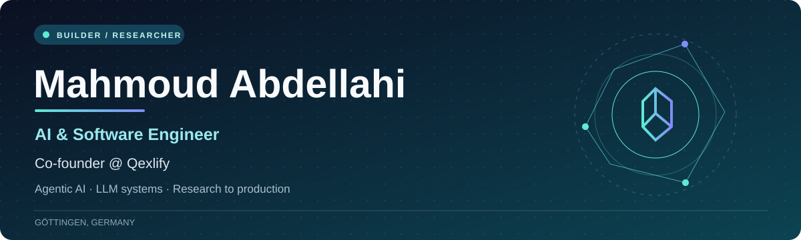
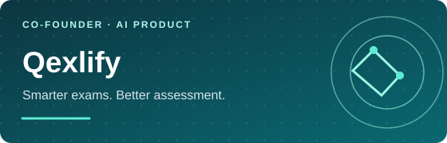
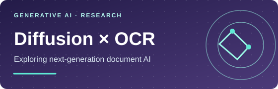

 

### Building AI that works beyond the demo.

I turn **AI research into useful products** — from agentic LLM workflows and retrieval systems to full-stack applications, computer vision, and scalable ML infrastructure.

**[Selected work](#selected-work) · [What I do](#what-i-do) · [Research](#research--recognition) · [Connect](#connect)**

---

## A little about me

I’m **Mahmoud Abdellahi**, an AI & Software Engineer based in Göttingen, Germany.

- 🚀 **Co-founder of [Qexlify](https://qexlify.com)** — building an AI-powered examination platform with intelligent exam creation and grading workflows.
- 🧠 **AI & Software Engineering at [GWDG](https://www.gwdg.de/)** — working on an HPC examination platform with LLM-based grading agents, RAG, and production deployments.
- 🔬 **Research intern at GIPP Lab, University of Göttingen** — exploring reasoning in diffusion models.
- 🎓 **M.Sc. student, Applied Computer Science (Data Science)** at the University of Göttingen.

I enjoy owning the full journey: **prototype → evaluate → engineer → deploy**.

## Selected work

<table>
<tr>
<td width="50%" valign="top">

 <b><a href="https://qexlify.com">Qexlify ↗</a></b> · <i>Co-founder</i> 
Co-building an AI-powered platform for creating, administering, and grading exams.  
<code>AI Product</code> <code>EdTech</code> <code>Full-stack</code>
</td>
<td width="50%" valign="top">

 <b><a href="https://github.com/m-mahmoud-mohamed/KooraKit">KooraKit ↗</a></b> · <i>B.Sc. thesis</i> 
Football analytics with player and ball tracking, heatmaps, speed metrics, and LLM-generated comparison reports.  
<code>YOLOv8</code> <code>Computer Vision</code> <code>LLMs</code>
</td>
</tr>
<tr>
<td width="50%" valign="top">

 <b><a href="https://github.com/m-mahmoud-mohamed/Discrete-OCR-Diffusion-Models">Diffusion for OCR ↗</a></b> · <i>Research</i> 
Exploring diffusion-based vision-language models for document recognition, with rigorous benchmarking against autoregressive OCR.  
<code>Diffusion</code> <code>VLMs</code> <code>PyTorch</code>
</td>
<td width="50%" valign="top">

 <b><a href="https://github.com/m-mahmoud-mohamed/MeetingQA">MeetingQA ↗</a></b> · <i>LLM application</i> 
Ask questions about meetings and generate summaries using transcription, semantic retrieval, and a fine-tuned Phi-3 model.  
<code>RAG</code> <code>LangChain</code> <code>Phi-3</code>
</td>
</tr>
</table>

**More:** [AraQA — Arabic Generative QA](https://github.com/m-mahmoud-mohamed/AraQA-An-Arabic-Generative-Question-Answering-Model-for-Authentic-Religious-Text) · [MLOps Deployment Pipeline](https://github.com/m-mahmoud-mohamed/MLOps-Pipeline-for-Machine-Learning-Deployment) · [All repositories](https://github.com/m-mahmoud-mohamed?tab=repositories)

## What I do

| Focus | Tools & technologies |
|:--|:--|
| **Agentic AI & LLM engineering** | RAG, LangChain, Hugging Face, vector databases, tool orchestration |
| **Machine learning & research** | PyTorch, TensorFlow, scikit-learn, NLP, computer vision, diffusion models |
| **Full-stack engineering** | Python, TypeScript, JavaScript, React, Node.js, REST APIs, GraphQL, SQL |
| **Systems & deployment** | Docker, Git, MLOps, WebSockets, HPC, SLURM, GPU clusters |

## Research & recognition

- 📄 **Publication:** *AraQA: An Arabic Generative Question-Answering Model for Authentic Religious Text* — **IEEE JAC-ECC 2023**. [Explore project ↗](https://github.com/m-mahmoud-mohamed/AraQA-An-Arabic-Generative-Question-Answering-Model-for-Authentic-Religious-Text)
- 🏅 **Dean’s Honor List**, Nile University — Spring & Fall 2023.
- 🥈 **2nd place**, 17th Undergraduate Research Forum — Smart Agriculture System.
- 🥉 **3rd place**, NUAI Hackathon — plant disease detection using computer vision.

## Connect

Interested in **applied AI, agentic systems, research, or building products together**? I’d love to connect.

**[LinkedIn](https://www.linkedin.com/in/mahmoud--mohamed/) · [Email](mailto:mahmoudmohamedabdellahy@gmail.com) · [Qexlify](https://qexlify.com) · [Hugging Face](https://huggingface.co/MahmoudMohamed)**

Research-minded. Product-driven. Always building.

